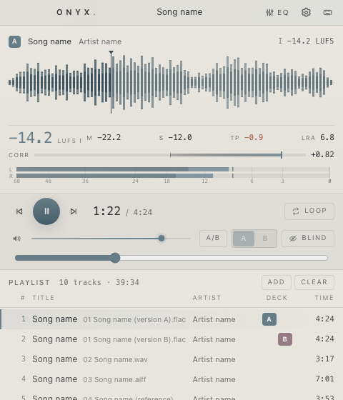
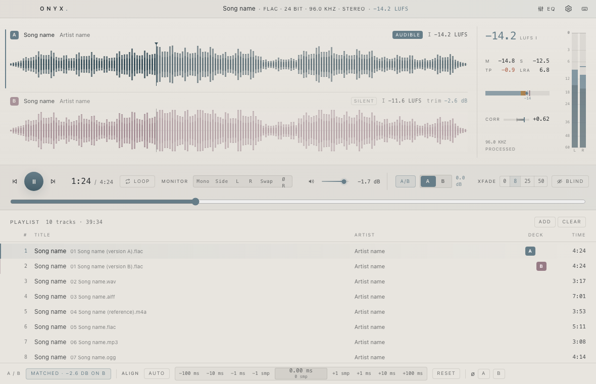
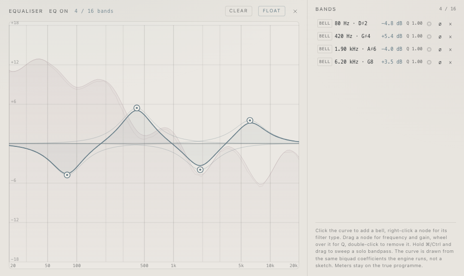
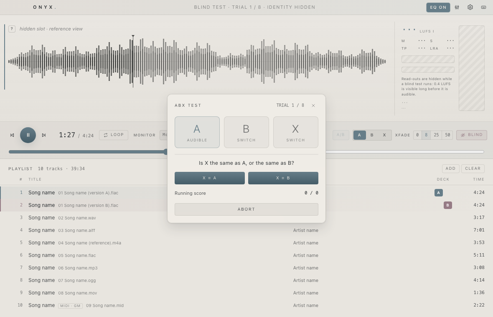
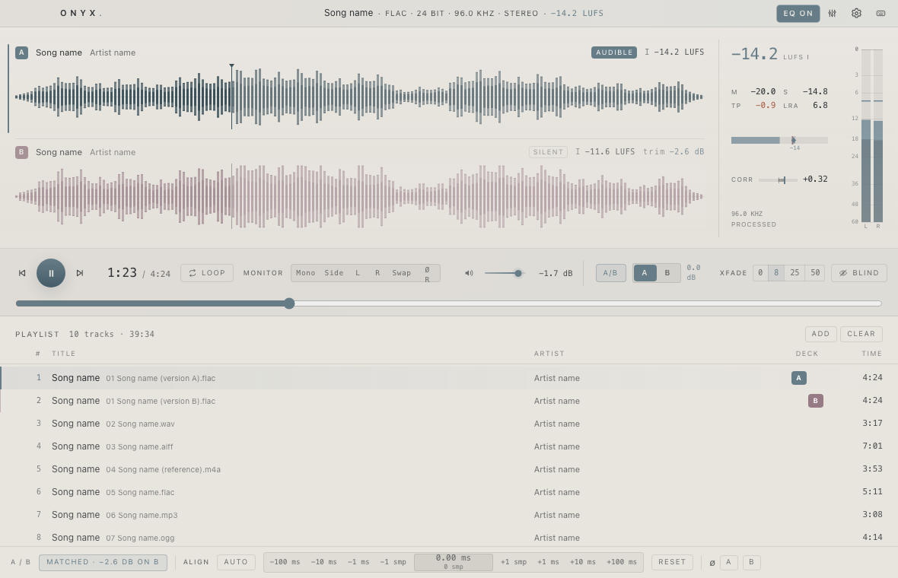

# Onyx


**Hear the difference between two mixes.** · 1.0.0

A desktop audio player for critical listening: switch between two tracks at the
same moment, match their loudness, inspect the signal, and test yourself blind.

**[Download](../../releases) · [Quick start](#compare-two-tracks) · [User guide](docs/guide.md) · [Build from source](CONTRIBUTING.md)**

**Customizable colors & themes.**



*A compact player. Expand the window when you want to compare.*

| You want to… | Onyx gives you… |
|---|---|
| Compare a mix, master, or encode | Two decks, one playhead, instant A/B switching |
| Make a fair comparison | Optional loudness matching and timing alignment |
| Check what you hear | LUFS, true peak, correlation, and monitor folds |
| Listen without seeing the answer | Blind A/B and ABX tests |
| Explore a frequency range | A separate EQ window with spectrum and band solo |

## Download

Get a build from **[Releases](../../releases)**, or
[build it yourself](#building-releases) if no suitable download is available.

| Platform | Choose | Requirement |
|---|---|---|
| Mac — Intel or Apple silicon | Universal `.dmg` | macOS Big Sur **11.3+** |
| Windows PC | x64 setup `.exe` | **Windows 10/11**, WebView2 Runtime |

On Mac, open the disk image and drag Onyx into Applications. On Windows, run
the installer; it installs WebView2 if needed, which requires internet access.
For offline Windows setup, install Microsoft's Evergreen WebView2 Runtime first.
Builds are unsigned unless the release says otherwise; see the
[installation guide](docs/guide.md#install-and-open).

Onyx runs locally. No account, upload, or music library setup is needed.

## Compare two tracks

1. **Open your files.** Click **Open files** on the empty screen, or drop files
   and folders into the window. The first track starts playing.
2. **Choose the other version.** Click **B** beside the second track in the
   playlist. This assigns B without changing the comparison switch.
3. **Enable comparison.** Click **A/B** in the transport. Then press **A** or
   **B**, or click its deck buttons. Both tracks share the same playhead.
4. **Make it fair.** Turn on **Level match** to attenuate the louder track.
   Use **Auto** if the tracks start at different times. Shift-drag a waveform
   to loop a passage.

**Open replaces the playlist. Add and drop append to it.** Clicking a playlist
row loads and plays it on the current deck; the other deck stays unchanged.
Use the **A/B deck buttons** to assign a specific deck. Comparison
starts off each session; enable it when ready. A file dropped onto a waveform
loads that deck. New waveforms appear with a brief transition; playback does
not wait for the animation. Reduced motion disables the transition.



## Explore the sound

Press **E** to open and enable the equaliser. **EQ ON** stays highlighted in the
main window while enabled bands are filtering, even after the editor closes.
**Click EQ ON to turn filtering off directly; EQ OFF turns it back on.** The
separate EQ icon opens the editor. Shift+E also toggles processing.

Click the graph to add a band, drag to adjust, and hold **⌘/Ctrl while dragging** to audition a frequency range. Closing the
window stops its analyser; the EQ settings remain active until bypassed.



## Test yourself blind

Click **Blind**, choose **ABX** or **A/B**, then **Begin**. If the decks are empty,
Onyx explains how to choose the tracks first. During a test, listen to the slots,
vote, and review the score when the run finishes. **Abort** ends the run early.



## Make it comfortable

The default is a Morandi palette: warm stone, mist-blue controls, and dusty-rose reference accents. Open **Settings → Simple** to choose dark,
light, or system appearance, an accent,
fonts, and interface size. The theme-code editor lets you import or edit a full
look. Keyboard navigation and reduced-motion preferences are supported.



*Screenshots use placeholder song/artist metadata and simulated audio in the
browser preview.*

## Essential keys

| Key | Action |
|---|---|
| Space | Play/pause; activates a focused button |
| A / B | Listen to deck A / B |
| Shift+A / Shift+B | Assign the selected playlist track |
| ← / → | Seek five seconds; Shift makes it one second |
| E | Open/close EQ; Shift+E bypasses it |
| M / L | Mute / loop |
| ⌘/Ctrl+O | Open files and replace the playlist |
| ? | All shortcuts |

When a playlist row has focus, ↑/↓ selects a track; Enter or Space plays it.
[More controls and recovery tips →](docs/guide.md)

## Known limitations

- Audio is decoded into memory, with a default **1 GiB per deck** budget.
  Long tracks can be truncated; Onyx reports this. There is no disk-streaming mode.
- Alignment corrects a constant time offset, not tempo or different edits.
- Loudness analysis normally needs a complete decode; cached results appear sooner.
- No playlist persistence, library database, cue sheets, or gapless transitions
  between playlist rows. Settings and the loudness cache persist.
- Mac universal builds and browser checks pass. Actual Big Sur and Windows 10
  audio/device behavior still needs testing on those systems. The full Windows
  installer has not been verified in the current Mac environment.

## Development

Requires Node.js **^20.19 or ≥22.12**, Rust stable, and the platform toolchain:
Xcode Command Line Tools on macOS; Visual Studio C++ Build Tools and the Windows
SDK on Windows. Linux is a development target; see [setup details](CONTRIBUTING.md).

```sh
npm ci
npm run tauri dev
```

For a UI-only preview: `npm run dev:mock`.
[Checks, architecture rules, and screenshot regeneration →](CONTRIBUTING.md)

## Building releases

Push to `main` or `master` to build production Mac and Windows packages and
publish version **1.0.0** directly to GitHub Releases after verification.
No draft or tag push is required. Later updates require a new version;
already published releases are preserved.
[First push to a new repository →](docs/releasing.md#first-push-to-a-new-repository)

```sh
# macOS: universal app and disk image
./scripts/build-mac.sh
```

```powershell
# Windows x64: NSIS installer
.\scripts\build-windows.ps1
```

[Signing, versioning, and release checks →](docs/releasing.md)

## Security posture

Media, archives, and theme documents are treated as untrusted input. The renderer
has restricted permissions, archive extraction has size/path limits, and parser
failures are contained where possible. Read [SECURITY.md](SECURITY.md) for the
reporting policy and [SPEC.md](SPEC.md) for implementation contracts.

## License

Copyright © 2026. All rights reserved. No license is granted for the original
Onyx code. Use, modification, and distribution require the copyright holder's
permission. Bundled third-party components retain their own licenses and
attribution: [THIRD-PARTY.md](THIRD-PARTY.md).

## Automatic downloads

Every successful build from a push to `main` refreshes the public **1.0.0** release.
All required platform builds and checks must pass first. Downloads use
`App-1.0.0-OS-architecture.ext`, such as `App-1.0.0-macOS-universal.zip`
or `App-1.0.0-Windows-x64.exe`. See [release automation](.github/RELEASES.md)
for the exact packages, checksums, and retry behavior.
